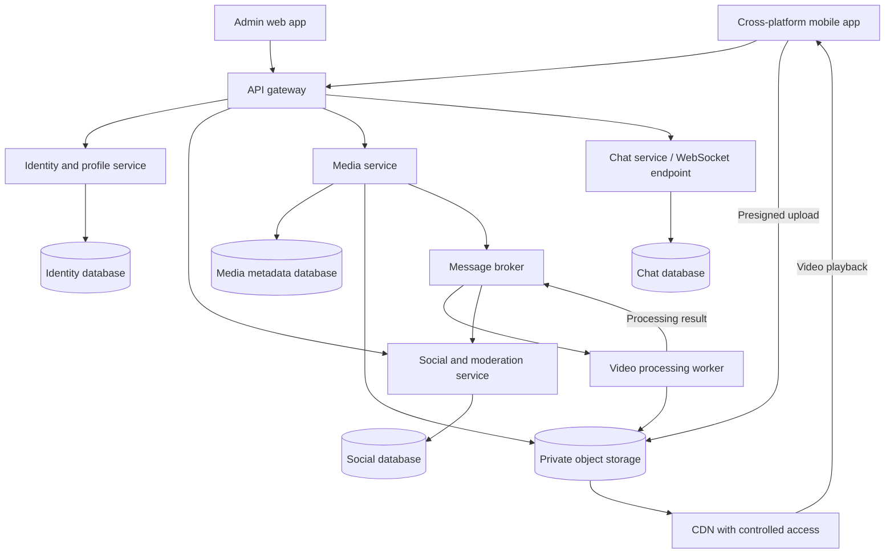

# Proposed architecture

Status: proposed. See [ADR-0001](adr/0001-architecture-style.md).

## Style comparison

| Style | Benefits | Costs for YouScout |
| --- | --- | --- |
| Layered monolith | Simple deployment and transactions; easy four-person development. | Media and chat scaling coupled to the application; growing deployment scope. |
| Modular monolith with workers | Clear boundaries and low operating cost; independent media jobs. | Main application still scales and deploys together. |
| Domain-oriented microservices with events | Independent media, feed and chat scaling; separate failure and data ownership. | Distributed consistency, contracts, observability and operations add complexity. |
| Predominantly serverless | Elastic background execution and reduced server management. | Provider coupling, execution limits and real-time connection constraints require care. |

Propose a small domain-oriented service architecture with asynchronous media processing. Avoid making every entity a service. A modular monolith remains a valid fallback if the team cannot operate the proposed distributed foundation within its delivery schedule.

## Topology

## Responsibilities and proposed stack

- Identity/profile: third-party identity integration, profiles and account lifecycle.
- Social/moderation: feed, publications, comments, likes, ratings, follows, blocks, reports, hashtags, skills and admin dashboard.
- Media: upload authorization, processing state, media metadata and deletion orchestration.
- Chat: authenticated real-time connections and persisted messages.
- Worker: validate and transcode videos and create thumbnails.

Proposed technologies: React Native with Expo for mobile; TypeScript and NestJS for backend services; React for admin; PostgreSQL for service-owned data; RabbitMQ for work/event delivery; S3-compatible object storage and a CDN. Redis is optional when a measured caching or rate-limit need exists. This stack is not mandated by the assignment or installed in this repository.

## Design rules

- Services own their schemas; no direct cross-service database queries.
- Use synchronous APIs for immediate validation and reads; events for processing and propagation.
- Publish events reliably with a transactional outbox; consumers are idempotent.
- Keep the social service cohesive for the initial MVP rather than splitting every feature.
- Authorize actions server-side and apply admin role checks to every back-office route.
- Propagate trace IDs, collect logs and metrics, and expose readiness checks.
- Version API/event contracts and record substantial changes as ADRs.

## Upload lifecycle

Authorize upload, create a pending media record, upload directly to storage, confirm completion, enqueue processing, validate/transcode, then publish a success event. Social publishes feed metadata only after success. Failed jobs record an error and support bounded retry. Deletion and disabling must coordinate metadata, object storage and CDN access.

## Main risks

Distributed failures can leave orphan media or stale feed entries: add reconciliation jobs. Duplicate messages require deduplication. Moderation must affect media access as well as feed visibility. A single-region launch does not itself provide worldwide disaster recovery or guaranteed global latency.
