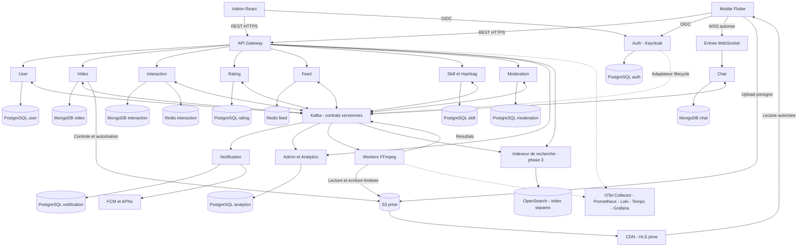

# Conception architecturale retenue

Statut : cible retenue par le porteur du projet. Implémentation à réaliser. La décision remplace la proposition initiale à quatre services ; les anciens ADRs sont conservés comme remplacés.

## Style : microservices orientés événements

Les commandes et lectures interactives passent principalement par REST. Les changements utiles à d'autres domaines sont diffusés par Kafka. Le mobile n'accède ni à Kafka ni aux bases. L'API Gateway traite les API métier ; OIDC, WebSocket, upload S3 et lecture CDN utilisent leurs points d'entrée explicitement autorisés.

## Comparaison qualitative

Notes de 1 à 5, appréciations pour la cible envisagée, pas résultats de benchmark. Pondérations : scalabilité 5, disponibilité 4, performance 4, évolutivité 4, testabilité 3, simplicité 2 ; maximum 110.

| Style | Scal. | Dispo. | Perf. | Évol. | Tests | Simple | Total |
| --- | --- | --- | --- | --- | --- | --- | --- |
| Monolithe en couches | 1 | 2 | 3 | 1 | 2 | 5 | 45 |
| Monolithe modulaire | 2 | 2 | 3 | 3 | 3 | 4 | 59 |
| Service-based | 3 | 4 | 3 | 3 | 3 | 3 | 70 |
| Serverless | 4 | 4 | 3 | 3 | 3 | 3 | 75 |
| Event-driven pur | 4 | 4 | 4 | 4 | 2 | 1 | 76 |
| Space-based | 5 | 4 | 5 | 2 | 2 | 1 | 77 |
| Microservices et événements | 5 | 5 | 4 | 5 | 4 | 1 | 95 |

Le score élevé de disponibilité suppose des réplicas et dépendances résilientes ; il n'est pas intrinsèque aux microservices. Les communications réseau peuvent réduire la performance ; l'avantage attendu vient du découplage et des projections. La sécurité reste un critère éliminatoire transversal, même hors de cette grille. L'écart de notes avec le monolithe est sensible au poids donné à l'exploitation et doit être défendu à la soutenance.

Un monolithe peut être répliqué et utiliser des workers externes : il n'est pas incapable de monter en charge. Le service-based reste un compromis valable et n'impose pas forcément une base partagée. Le serverless peut porter des API et des tâches adaptées, avec attention aux contraintes d'exécution. Le style purement événementiel rend les lectures interactives et le diagnostic moins directs. Le space-based ne règle pas le stockage et la diffusion vidéo. Le choix retenu privilégie ici les frontières métier, les projections rejouables et les déploiements indépendants, au prix d'une exploitation plus complexe.

## Topologie cible

Les bases dessinées sont logiquement distinctes. Plusieurs peuvent partager un cluster au démarrage, mais avec identifiants, permissions et migrations séparés. Les autres services et infrastructures sont également instrumentés ; les deux liens d'observabilité illustrent le principe sans encombrer le diagramme. L'indexeur de recherche est un composant de projection technique, pas un douzième domaine métier.

## Onze services logiques

Auth, User, Video, Interaction, Rating, Feed, Chat, Skill/Hashtag, Moderation, Notification, Admin/Analytics. Auth est assuré par Keycloak plutôt que par un gestionnaire de mots de passe maison. Les workers ne sont pas comptés comme services métier. Voir [le catalogue](SERVICES.md) pour les données, API et événements de chacun.

## Publication vidéo

1. User authentifié : Video vérifie propriétaire, quota et métadonnées, crée `PENDING_UPLOAD` et une clé objet unique.
2. Le mobile charge le fichier vers S3 avec une autorisation courte. Le binaire évite les services métier.
3. Le mobile confirme la fin ; Video contrôle l'objet avec S3, fixe `UPLOADED` et écrit une outbox atomiquement. Une réconciliation retrouve les confirmations manquantes.
4. Le relais outbox publie `VideoUploaded` ; FFmpeg valide le fichier et produit HLS et miniatures dans un préfixe de traitement unique.
5. `VideoProcessed` est consommé par Video. Une transaction vérifie version et statut ; seule une vidéo encore autorisée devient `PUBLISHED`, avec outbox `VideoPublished`.
6. Feed, indexation, notifications et analytics actualisent leurs projections. Le lecteur reçoit une autorisation CDN après contrôle de visibilité.

Une notification objet peut compléter l'étape 3 via S3 -> SQS/EventBridge -> adaptateur -> Video. **S3 ne publie pas nativement directement dans Kafka** ; le chemin choisi doit être implémenté et dédupliqué. Les workers ne modifient pas directement la base Video.

## Règles

- Un service est seul propriétaire de ses écritures et migrations.
- REST pour réponse immédiate ; événements pour propagation. Éviter les chaînes synchrones longues, autoriser les contrôles d'accès nécessaires avec timeouts.
- Outbox et consommateurs idempotents ; aucune promesse de transaction globale « exactly once ».
- CQRS limité au feed et aux projections utiles ; pas d'obligation d'event sourcing intégral.
- Un blocage, retrait ou compte fermé doit être appliqué au feed, au chat et aux nouvelles autorisations média ; voir [les règles de sécurité](SECURITE_ET_MODERATION.md).
- Services réplicables sans données métier durables sur disque local ; connexions WebSocket et fichiers temporaires des workers restent des états transitoires à gérer.
- Redis n'est pas l'unique archive du feed : reconstruction par événements retenus et snapshots des propriétaires si nécessaire.
- Kubernetes ne remplace ni les sauvegardes, ni l'idempotence, ni les tests de panne.

## Risques et réponses

| Risque | Réponse |
| --- | --- |
| Onze domaines pour quatre personnes | Livrer les six services du socle puis étendre, gabarit commun Spring Boot |
| Multiplication des bases | Mutualisation physique possible avec séparation logique et droits stricts |
| Kafka indisponible ou doublons | Outbox persistante, retries bornés, déduplication et file d'échec |
| Projection en retard | Versions, métrique de lag, contrôle de visibilité avant accès sensible |
| CDN contenant une vidéo retirée | Refus de nouveaux accès, signatures courtes, invalidation et révocation renforcée si nécessaire |
| Budget libre interprété comme capacité illimitée | Mesurer consommation, temps d'exploitation et charge réelle |

Les dix ADRs principaux sont dans [l'index](adr/README.md). La [roadmap](ROADMAP.md) sépare la cible complète de la première démonstration.
