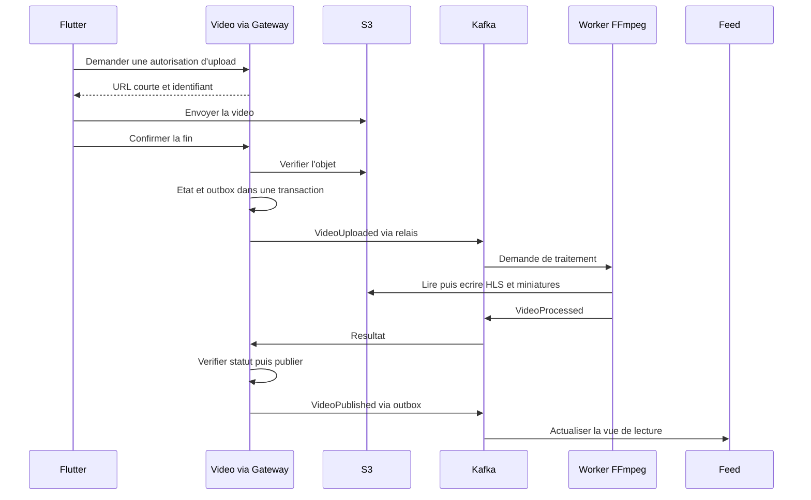

# Comprendre l'architecture YouScout

## L'idée

L'application est découpée en équipes spécialisées qui communiquent. User gère les profils, Video les publications vidéo, Interaction les commentaires et likes, Rating les notes, Chat les messages. Chaque service possède ses données et peut être déployé séparément. L'application Flutter assemble leurs résultats à travers les points d'entrée autorisés.

La Gateway est l'accueil : elle dirige une requête vers le bon service et applique des protections communes. Keycloak est le gestionnaire d'identité : il authentifie l'utilisateur. Un JWT est une preuve d'identité signée avec une durée limitée ; le service vérifie encore si cette personne a le droit d'agir sur la ressource.

Kafka est un journal de changements. Un service annonce « cette vidéo est publiée » ; Feed, Notification et Analytics réagissent chacun sans obliger Video à attendre tous leurs traitements. Ce mécanisme ajoute un délai de propagation qu'il faut mesurer et gérer.

## Exemple : publier une vidéo

**Pourquoi S3 ?** Pour conserver les fichiers. **Pourquoi MongoDB ?** Pour les métadonnées Video, pas les fichiers eux-mêmes. **Pourquoi FFmpeg ?** Pour transformer la vidéo en formats de lecture. **Pourquoi le CDN ?** Pour livrer les segments vidéo près du lecteur. **Pourquoi Kafka ?** Pour coordonner les traitements et informer plusieurs consommateurs.

La confirmation d'upload ne signifie donc pas que la vidéo est déjà visible. L'interface montre les états en attente, traitement, publié ou échec.

## Exemple : consulter le feed

Calculer toutes les relations et tous les compteurs à chaque défilement coûterait cher. Feed prépare une vue adaptée à la lecture dans Redis, puis répond rapidement. C'est le principe de CQRS : le modèle de lecture peut être différent du modèle d'écriture. Cette vue se reconstruit à partir des propriétaires et des événements ; Redis n'est pas l'archive unique.

Au départ, classer chronologiquement les publications suivies et ajouter une découverte simple. Plus tard, le fan-out hybride pré-calcule les publications des auteurs ordinaires, tandis que celles des comptes à très nombreux abonnés sont fusionnées à la lecture. Le seuil se mesure ; ce mécanisme ne garantit pas à lui seul l'équité. Évaluer l'exposition des nouveaux talents et éviter un classement uniquement fondé sur les likes.

## Exemple : une panne

Si un worker s'arrête, la vidéo reste en attente et un autre traitement peut reprendre. Si Kafka s'arrête, l'outbox garde les changements à publier. Si Chat est indisponible, les API du feed peuvent continuer, sous réserve de leurs propres dépendances. Cela exige des timeouts, réplications et tests ; le découpage ne crée pas automatiquement la disponibilité.

## Exemple : le chat

Le mobile ouvre une connexion WebSocket authentifiée. Chat enregistre le message avant l'accusé d'acceptation, puis le transmet au destinataire connecté. Un identifiant client évite le doublon après reconnexion. « Accepté par le serveur », « livré » et « lu » sont trois états différents. Les notifications push préviennent un utilisateur absent, sans remplacer l'historique persistant.

## Pourquoi Kubernetes ?

Docker emballe chaque composant. Kubernetes exécute les conteneurs, remplace les instances défaillantes et organise leurs déploiements. HPA ajuste les réplicas selon les métriques configurées ; KEDA peut utiliser le retard Kafka pour les workers. Les bases et Kafka restent des systèmes avec état : leur durabilité vient aussi du stockage, de la réplication et des sauvegardes.

## Points à retenir pour la revue d'architecture

Le choix répond à la croissance et aux charges différentes des domaines. Son coût principal est la coordination de plusieurs services. Le MVP livre une chaîne vidéo complète avant d'ajouter chat, notes, modération puis dashboard. Les fonctionnalités suivantes sont organisées dans la roadmap produit. Comparer les choix concrets dans [Outils et alternatives](OUTILS_ET_ALTERNATIVES.md).
